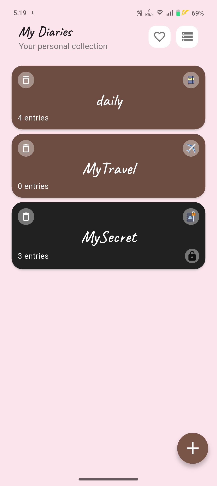
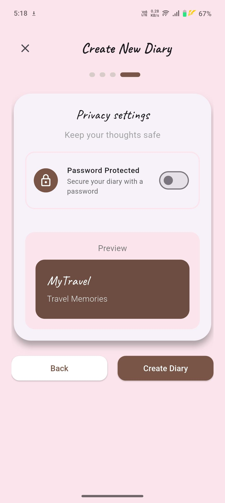
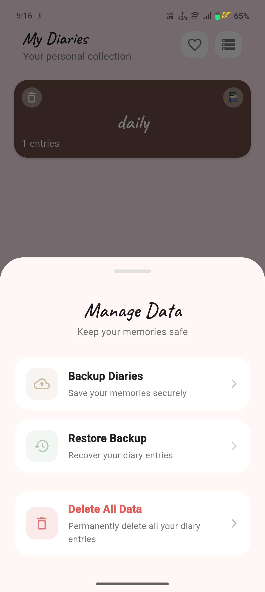
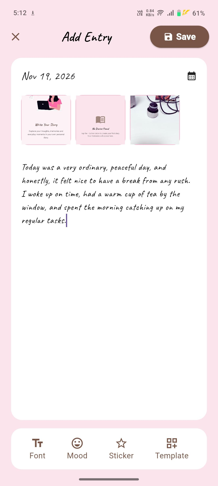
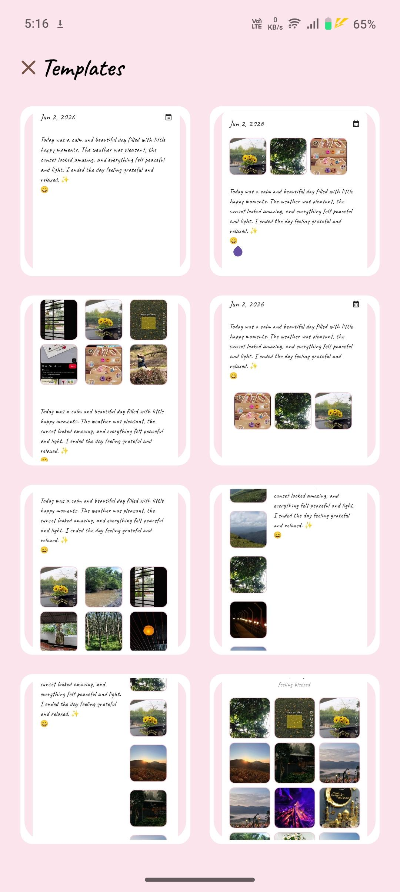
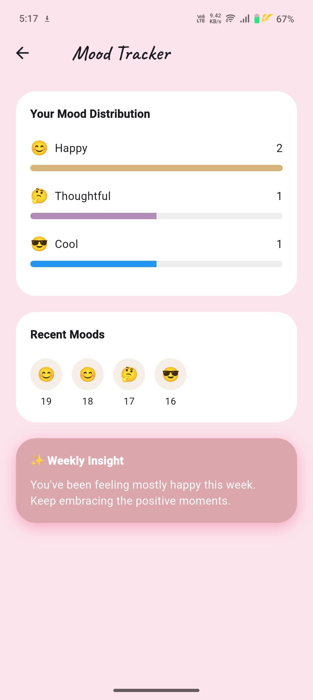

# MyDiary App

A personalized digital diary application built with Flutter, designed to make journaling more creative, expressive, and personal.

Create multiple diaries, capture everyday memories, and design beautiful diary entries using customizable page templates, photos, videos, stickers, and different fonts. Keep personal memories private with password-protected diaries.

## Features

### 📔 Multiple Diary Management
- Create and manage multiple diaries.
- Customize diaries with different themes and categories.
- Organize memories into separate diaries.
- Create private diaries with password protection.

### 🎨 Creative Diary Entries
- Add images and videos directly from the gallery.
- Add stickers and emojis to personalize diary pages.
- Choose from 15 different fonts for a personalized writing experience.
- Add titles, subtitles, and diary content.
- Edit and update existing diary entries.

### 😊 Mood Tracking
- Select a mood for each diary entry.
- Track different emotions through daily entries.
- View mood distribution and weekly mood insights.

### 📅 Calendar Navigation
- Browse diary entries by date.
- Navigate between dates using a calendar.
- View and manage memories associated with specific dates.

### 💾 Backup & Restore
- Create ZIP backups of diary data.
- Restore diary data from backup files.
- Include associated media files in backups.

## 📱 Screenshots

### App Introduction
<p align="center">
  
</p>


### Diary Management
<p align="center">
   
   &nbsp;&nbsp;&nbsp;&nbsp;
  
   &nbsp;&nbsp;&nbsp;&nbsp;
  
</p>

### Creative Diary Entries
<p align="center">
  
      &nbsp;&nbsp;&nbsp;&nbsp;

  
</p>

### Mood Tracking
<p align="center">
  
</p>


## Tech Stack

| Technology | Purpose |
|---|---|
| Flutter | Cross-platform application development |
| Dart | Programming language |
| SQLite (sqflite) | Local database management |
| Riverpod | State management |
| Image Picker | Image selection |
| Video Player | Video playback |
| Table Calendar | Calendar-based navigation |
| Archive | ZIP backup and restore |
| Path Provider | Local file management |
| Emoji Picker Flutter | Emoji selection |

## Project Architecture

The application is organized into separate components to manage UI, application state, data models, and database operations.

- **Screens:** Handle application UI and user interactions.
- **Models:** Represent diary entries, diaries, media files, moods, and templates.
- **Providers:** Manage application state using Riverpod.
- **Services:** Handle database operations and supporting application functionality.
- **Widgets:** Provide reusable UI components.

## Database

The application uses SQLite through the `sqflite` package for local data persistence.

### Main Tables

**Diary**
- Diary ID
- Diary name
- Theme information
- Category information
- Privacy settings
- Password

**Diary Entries**
- Entry ID
- Diary ID
- Content
- Entry date
- Selected font
- Mood
- Template index
- Media paths
- Title
- Subtitle

## Getting Started

### Prerequisites

- Flutter SDK
- Dart SDK
- Android Studio or Visual Studio Code

### Installation

1. Clone the repository:

   ```bash
   git clone https://github.com/subina-khader/diary-app.git
   ```

2. Navigate to the project directory:

   ```bash
   cd diary-app
   ```

3. Install dependencies:

   ```bash
   flutter pub get
   ```
   
4. Run the application:

   ```bash
   flutter run
   ```

## Future Enhancements

- Additional diary templates and customization options.
- Enhanced diary organization and search.
- Further privacy and security improvements.

## Author

Developed as a personal Flutter project.
